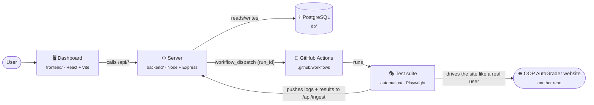

# OOP AutoGrader — Automated Testing System


A platform that **runs tests by itself** against the [OOP AutoGrader](https://oop-autograder.vercel.app) website (the site that grades students' OOP assignments).
A user picks a test suite in the dashboard → the server orders a run → the Playwright suite drives the real website like a user → results, logs and reported bugs are pushed back for the report screens.

> [!IMPORTANT]
> **Two systems, don't mix them up.** This repo is the *testing platform*. The system under test (OOP AutoGrader, Java/Spring Boot + React) lives in another repo and **has no code here**. Details: [`docs/Explain.md`](docs/Explain.md).

## Architecture at a glance



| Part | Folder | What it does |
|---|---|---|
| Dashboard | `frontend/` | 13 screens: sign-in, overview, test cases, start a run, history, reports, user management |
| Server | `backend/` | 54 API endpoints: permission checks, creating runs, taking in results, statistics |
| Test suite | `automation/` | Playwright specs + sample Java submissions, one per failure scenario |
| Database | `db/` + `migrate.js` | Table structure, upgrade steps, sample data |
| Docs | `docs/` | SRS, test plan, the `TC-01`→`TC-31` matrix, backend/frontend design |

The server **does not run** Playwright itself (Vercel's serverless runtime can't run chromium) — it asks GitHub Actions to do it.

## One-time setup

You need **Node.js 20+** and **PostgreSQL**. To set up a local database: [`db/SETUP-LOCAL.md`](db/SETUP-LOCAL.md).

```bash
git clone <repo> && cd oop-autograder-testing
cd backend && npm install && cd ..
cd frontend && npm install && cd ..
# deprecated
# cd automation && npm install && npx playwright install chromium && cd ..
```

Create `backend/.env` (at minimum `DATABASE_URL` and `JWT_SECRET` — without them the server won't start):

```
DATABASE_URL=postgresql://root:<password>@localhost:5432/test_automation_db
JWT_SECRET=<openssl rand -base64 32>
```

For the test suite's own variables (test accounts, data prefixes) see [`.env.example`](.env.example) and [`docs/test-data-rules.md`](docs/test-data-rules.md).
**Never put real values in `.env.example`** — this repo is public.

Load the table structure and sample data:

```bash
node migrate.js
```

## Common commands

| Task | Command | Where |
|---|---|---|
| Run the server | `npm run dev` → http://localhost:5000 | `backend/` |
| Run the dashboard | `npm run dev` → http://localhost:5173 | `frontend/` |
| Create / upgrade the database | `node migrate.js` | repo root |
| Server tests | `npm test` | `backend/` |
| List every API endpoint | `npm run routes` | `backend/` |
| Frontend contract self-checks ⚠️ | `npm run check` | `frontend/` |
| Run the Playwright suite | `npm test` | `automation/` |
| Fetch a run plan from the server | `npm run plan` | `automation/` |

⚠️ `frontend/npm run check` guards the contract with the backend (test-step grammar, log line format, HTML report, search box). Change one of those files, or change a log message on the backend, and you **must run it again** — the build stays green while the UI breaks silently.

### Architecture map (floorplan)

An interactive map of the whole codebase; every file and every API endpoint has a name and a one-line description in Vietnamese.

**Just want to look at it?** Open [`docs/architecture/floorplan-map.html`](docs/architecture/floorplan-map.html) in any browser — one self-contained file, nothing to install.

To work on the map itself (needs Claude Code with the floorplan plugin):

```bash
node floorplan/serve.mjs      # → http://127.0.0.1:4378, with the Ask bar
```

Only the map's sources are committed (`floorplan/architecture.json` and `floorplan/descriptions/`); the generated files are not. Rebuild them from those sources with `/floorplan:floorplan`, then refresh the shared copy:

```bash
node floorplan/serve.mjs --export docs/architecture/floorplan-map.html --include flows,notes
```
