# Yêu cầu giao diện – Bản 3 (bản được ưu tiên)

> Nguồn: file `Capstone.md` nhóm gửi ngày 2026-10-20. Phần chữ **giống hệt**
> [`02-yeu-cau-giao-dien-v2.md`](./02-yeu-cau-giao-dien-v2.md); giá trị mới nằm ở **11 ảnh thiết kế**
> trong [`design/`](./design) và link Design.md. Ảnh base64 nhúng trong file gốc đã được tách ra
> file rời để md còn đọc/diff được.

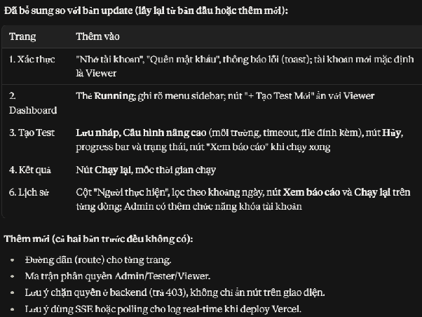

## 1. Xác thực (`/login`, `/register`)

- Form đăng nhập: email, mật khẩu (ẩn/hiện), Remember me, Quên mật khẩu.
- Form đăng ký: họ tên, email, mật khẩu, xác nhận mật khẩu. Tài khoản mới mặc định là Viewer, Admin nâng quyền sau.
- Social login Google/GitHub và thông báo lỗi (toast).

## 2. Dashboard (`/dashboard`)

- Sidebar có avatar, tên và nhãn vai trò. Menu: Dashboard, Tạo Test, Template, Lịch sử.
- Thẻ thống kê: Total, Pass Rate, Running, Failed gần nhất.
- Biểu đồ Pass/Fail theo ngày và bảng 5–10 test run gần đây.
- Nút "+ Tạo Test Mới" (ẩn với Viewer).

## 3. Tạo & Chạy Test (`/tests/new`)

- Dropdown Chọn Template, tự điền Tên, Yêu cầu, Expected.
- Tên test, Yêu cầu test, Phạm vi test (UI/API/DB...), Expected Output.
- Cấu hình nâng cao: môi trường, timeout, file đính kèm.
- Nút: Run Test, Lưu nháp, Lưu thành Template (Admin/Tester).
- Panel Real-time Logs ngay bên dưới, gồm progress bar, trạng thái và nút Hủy. Chạy xong có nút "Xem báo cáo".

## 4. Kết quả & Báo cáo (`/runs/:id`)

- Thẻ PASSED/FAILED, thời gian thực thi, mốc thời gian chạy.
- So sánh Expected vs Actual (diff viewer) và bảng từng bước.
- Xuất PDF, Export HTML, Copy link. Có thêm nút "Chạy lại".

## 5. Quản lý Template (`/templates`)

- Bảng: tên, người tạo, ngày cập nhật.
- Thêm, sửa, xóa (Admin/Tester). Viewer chỉ xem.

## 6. Lịch sử & Quản lý thành viên (`/history`, tab `/admin/users`)

- Tab Lịch sử: tìm kiếm, lọc Pass/Fail và theo ngày. Cột: ID, tên, người chạy, thời gian, trạng thái. Hành động: Xem báo cáo, Chạy lại (ẩn với Viewer).
- Tab Quản lý thành viên (chỉ Admin): danh sách user, gán Admin/Tester/Viewer, khóa tài khoản.

## Ma trận phân quyền

> ⚠️ Bảng này **chỉ có 3 vai trò**, thiếu `Dev`. Nguồn chuẩn là
> [`../architecture/SRS.md`](../architecture/SRS.md) mục 4 – xem bảng 4 vai trò ở [`Explain.md`](./Explain.md).

| Chức năng                        | Admin | Tester | Viewer |
| -------------------------------- | :---: | :----: | :----: |
| Xem Dashboard, Lịch sử, Báo cáo  |   ✔   |   ✔    |   ✔    |
| Run Test / Chạy lại / Hủy        |   ✔   |   ✔    |   ✘    |
| Thêm/sửa/xóa Template            |   ✔   |   ✔    |   ✘    |
| Xem Template                     |   ✔   |   ✔    |   ✔    |
| Quản lý thành viên               |   ✔   |   ✘    |   ✘    |

## Lưu ý khi triển khai

- Chặn quyền ở cả hai tầng: giao diện ẩn nút, middleware backend trả 403.
- Log real-time dùng SSE hoặc WebSocket. Nếu deploy Vercel thì nên dùng SSE hoặc polling, vì serverless không giữ WebSocket lâu.
- Nếu thiếu thời gian, ưu tiên làm trước các trang 1, 3, 4, 6. Trang 5 và tab quản lý thành viên làm sau.

## UI/UX

> Lưu ý: Thiết kế để tham khảo và hình dung chung về giao diện. Có thể thêm (nếu cần thiết) hoặc bỏ
> (nếu dư thừa) các chi tiết, không bắt buộc giống 100% để tiết kiệm thời gian.
>
> Thông tin kỹ thuật truy cập: [Design.md](https://docs.google.com/document/d/1SXQsNpDooNvhZqUPohQ_LjmyWJnPdZrIMXbech6soUQ/edit?usp=sharing)

Thương hiệu trong thiết kế: **OOP Grader**, tông màu indigo/violet (`#4f46e5`), nền `#f5f6fa`,
sidebar trắng có nhóm mục *CORE MODULES / ADMINISTRATION*, top bar có ô tìm kiếm + trạng thái cluster
+ chuông + avatar.

### 1. Login Screen

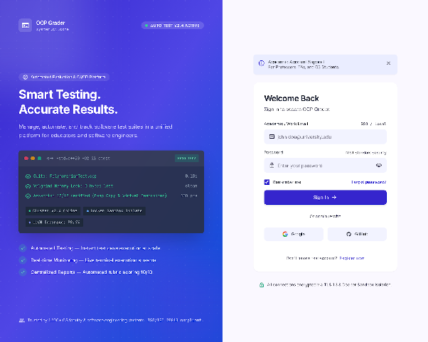

### 2. Forgot password Screen

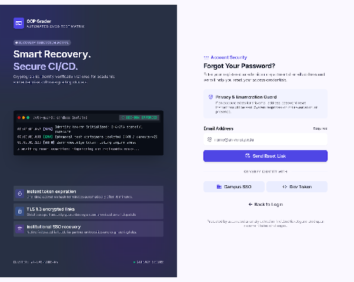

### 3. Register Screen

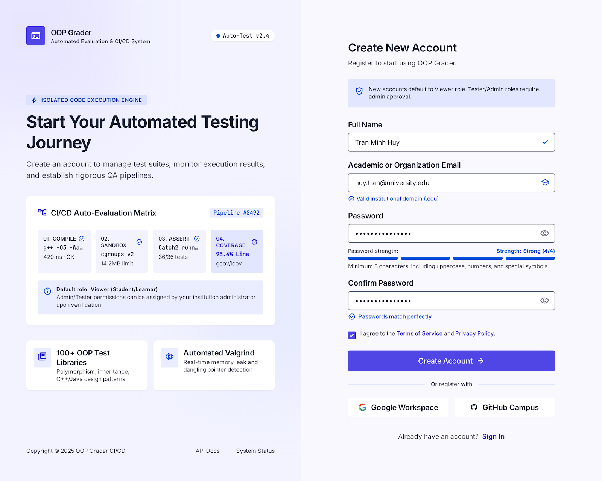

### 4. Dashboard Screen

**Bỏ avatar + logout trên drawer.**

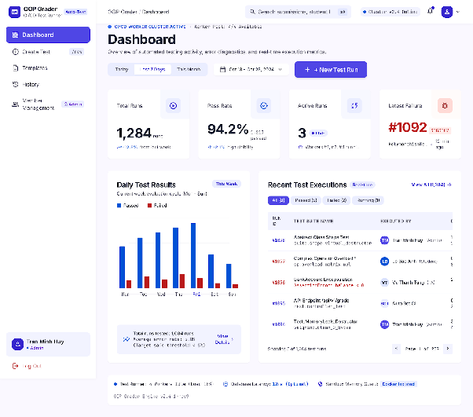

### 5. Create new test Screen

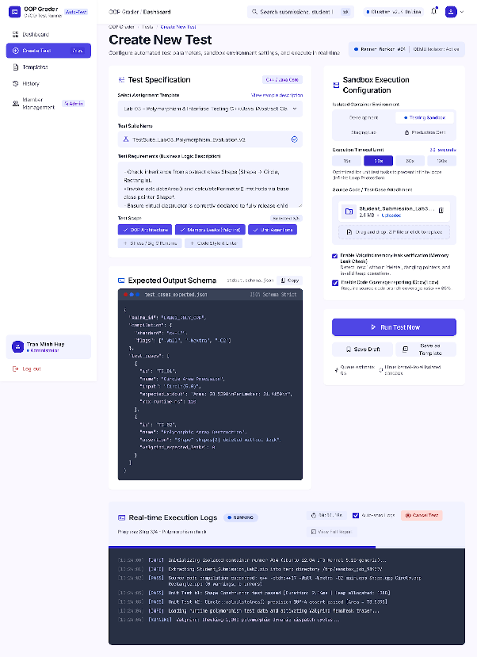

### 6. RunDetail Screen

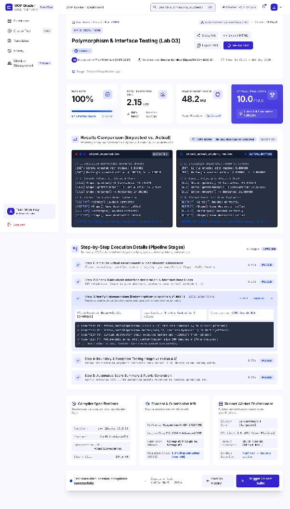

### 7. Test History Screen

**Thêm cột tick chọn để export.**

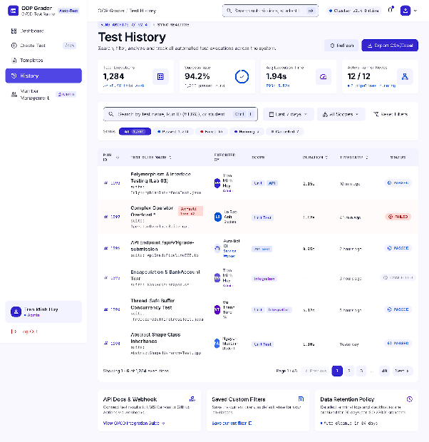

### 8. Template Management Screen

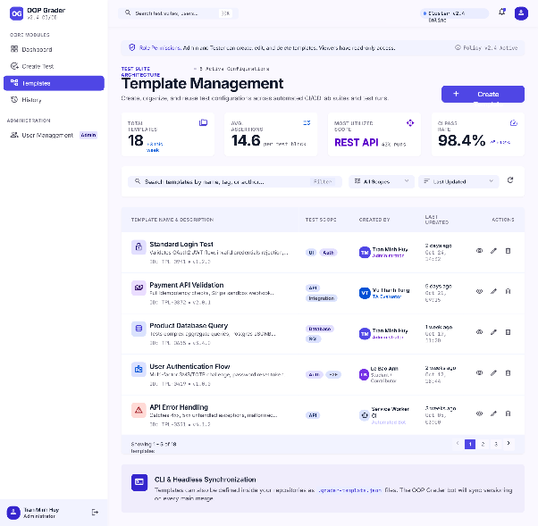

### 9. User Management Screen

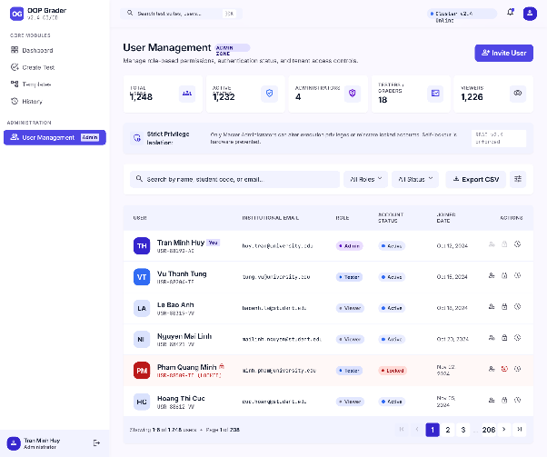

### 10. 403 unauthorized Screen

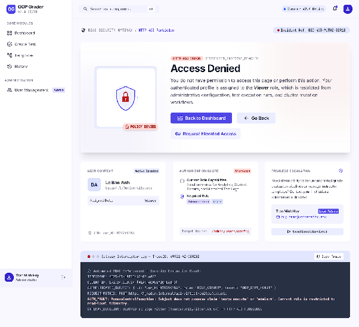
