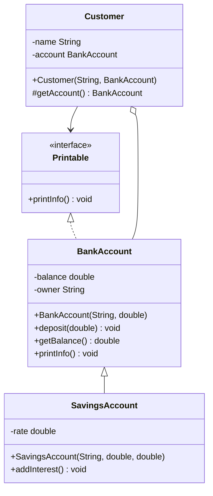

# Dữ liệu test của giảng viên (X6 – X7)

> **Phụ trách:** C · **Phụ thuộc:** B cung cấp bài nộp cho X7 và mã Java tham chiếu dùng chung ở TC-27.
> **Nguồn đối chiếu:** source SUT tại commit `01f6b47` – xem [`sut-reference.md`](./sut-reference.md).
> Mọi giá trị dưới đây là **thiết kế dữ liệu**, phải tạo thật qua giao diện web rồi ghi lại kết quả thực tế.

## 0. Quy ước chung

- Mọi dữ liệu nhóm tạo trên SUT mang tiền tố **`AUTOTEST_`** để dễ nhận biết và dọn (quy tắc X1).
- Chỉ thao tác **qua giao diện web**, không sửa trực tiếp Application DB của AutoGrader.
- Tài khoản giảng viên lấy từ `.env`: `TEST_LECTURER_IRN`, `TEST_LECTURER_PASSWORD`.
- Trang soạn cấu trúc: **`/lecturer-solution`** (Projects → Solution Management).

> 🛑 **Chặn:** bộ mã TC dùng ở đây theo [`test-case-matrix.md`](./test-case-matrix.md) (TC-23 → TC-27 là của **giảng viên**).
> `db/migrations/004_lecturer_steps_data.sql` đang gán TC-23 → TC-27 cho kịch bản **sinh viên** – phải chốt trước khi viết spec.
> Chi tiết: [`../database/phan-cong-db-va-du-lieu.md`](../database/phan-cong-db-va-du-lieu.md) mục D8.

---

# X6 – Dữ liệu cho TC-23 → TC-27

## 1. Lab và Challenge

Tạo ở `/lecturer-solution` → **Create Lab**.

| Trường trên giao diện | Giá trị |
| --- | --- |
| `Lab name` | `AUTOTEST_Lab_01` |
| `Quarter` | chọn học kỳ đang mở (giá trị thật tùy môi trường – ghi lại sau khi tạo) |
| Deadline (`Select Date...`) | một ngày trong tương lai, tránh chặn nộp bài ở X7 |

Challenge bên trong lab:

| Trường | Giá trị | Ghi chú |
| --- | --- | --- |
| Tên challenge | `AUTOTEST_Challenge_01` | |
| `classWeight` | `40` | Trụ cột 2 – Declaration Test |
| `mmdWeight` | `30` | Trụ cột 1 – MMD |
| `testcaseWeight` | `30` | Trụ cột 3 – Operational. Phải `> 0` thì trụ cột OT mới tính điểm |
| `hasMmd` | bật | Nếu tắt, TC-25 không có gì để kiểm |

> Cần thêm **`AUTOTEST_Lab_02`** (một challenge tối thiểu, không cần rubric đầy đủ) để TC-23 có thứ để **xóa**
> mà không phá dữ liệu của TC-24 → TC-27, và để TC-29 có ít nhất 2 cột lab trong Grade Matrix.

## 2. Cấu trúc lớp – cho TC-24

4 lớp, chọn vừa đủ để phủ các loại `DECLARING_TYPE` và `SCOPE` khác nhau.

> ⚠️ `scope` và `declaringType` lấy từ bảng `master_data` của SUT (category `SCOPE`, `DECLARING_TYPE`, `RELATION_TYPE`),
> nạp qua `GET /api/master-data`. **Không hard-code id** – spec phải đọc danh sách rồi chọn theo tên.

### 2.1 `Printable` — interface

| Thành phần | Scope | Kiểu / Tham số |
| --- | --- | --- |
| *(declaring type)* | — | `INTERFACE` |
| Method `printInfo` | `public` | return `void` |

### 2.2 `BankAccount` — class

| Thành phần | Scope | Kiểu / Tham số |
| --- | --- | --- |
| *(declaring type)* | — | `CLASS` |
| Field `balance` | `private` | `double` |
| Field `owner` | `private` | `String` |
| Constructor `BankAccount` | `public` | params `String, double` |
| Method `deposit` | `public` | return `void`, param `double` |
| Method `getBalance` | `public` | return `double` |
| Method `printInfo` | `public` | return `void` |

### 2.3 `SavingsAccount` — class, kế thừa `BankAccount`

| Thành phần | Scope | Kiểu / Tham số |
| --- | --- | --- |
| *(declaring type)* | — | `CLASS`, Extends `BankAccount` |
| Field `rate` | `private` | `double` |
| Constructor `SavingsAccount` | `public` | params `String, double, double` |
| Method `addInterest` | `public` | return `void` |

### 2.4 `Customer` — class

| Thành phần | Scope | Kiểu / Tham số |
| --- | --- | --- |
| *(declaring type)* | — | `CLASS` |
| Field `name` | `private` | `String` |
| Field `account` | `private` | `BankAccount` |
| Constructor `Customer` | `public` | params `String, BankAccount` |
| Method `getAccount` | `protected` | return `BankAccount` |

> `getAccount` để `protected` một cách có chủ ý: đây là mồi cho **TC-17** (partial credit khi sinh viên khai sai access modifier).

**Dữ liệu âm cho TC-24** – thứ *không được phép* xuất hiện, để kiểm việc bắt lỗi:

| Trường hợp | Mong đợi |
| --- | --- |
| Sinh viên thiếu hẳn lớp `Customer` | Lớp thiếu bị đánh fail riêng, các lớp còn lại vẫn pass |
| `balance` khai `public` thay vì `private` | Partial credit, không fail toàn bộ lớp |
| `deposit` khai `return double` thay vì `void` | Method đó fail, method khác vẫn pass |

## 3. Quan hệ MMD – cho TC-25

Tab **`MMD Relationships`** *(đúng chữ – không phải "MMD Relations")*.

Mũi tên dưới đây lấy từ `backend/src/main/java/grading/mmd/MmdRelationTypes.java` tại commit `01f6b47`:

| Source | Mũi tên | Target | `canonicalRelationType` |
| --- | --- | --- | --- |
| `BankAccount` | `<|--` | `SavingsAccount` | `inheritance` |
| `Printable` | `<|..` | `BankAccount` | `realization` |
| `Customer` | `o--` | `BankAccount` | `aggregation` |
| `Customer` | `-->` | `Printable` | `association` |

File `.mmd` tham chiếu (dùng cho fixture `valid_full` của lab này):



**Biến thể sai cho TC-25 và TC-16** (`mmd_partial_wrong`):

| Sửa gì | Mong đợi |
| --- | --- |
| Đổi `Customer o-- BankAccount` thành `Customer *-- BankAccount` | Quan hệ đó fail (`composition` ≠ `aggregation`), 3 quan hệ còn lại vẫn pass |
| Xóa dòng `Printable <|.. BankAccount` | Quan hệ thiếu bị flag, không fail cả sơ đồ |

> ⚠️ Mũi tên `--` (không mũi) được quy về `association` – xem commit `17f048e` của SUT (*"treat solid undirected `--` as association"*).
> Đừng dùng `--` làm case âm cho `association`, nó sẽ pass.

## 4. Operational Testcases – cho TC-26

Tab **`Operational Testcases`**. Lưu bằng nút **`Save Testcases`** – **khác** với **`Save Structure`** của tab cấu trúc.

> Thứ tự bắt buộc: khai báo xong class/field/method → bấm **Save Structure** → dropdown trong tab testcase mới có dữ liệu.

| # | Tên testcase | Type | Hidden | Nội dung |
| :-: | --- | --- | :-: | --- |
| 1 | `deposit increases balance` | Unit | ✘ **Example** | Member `deposit`, arguments `[50]`. Assertion `FIELD_STATE` trên `balance`, expected `50`, mode `EXACT` |
| 2 | `getBalance returns opening amount` | Unit | ✘ **Example** | Member constructor `BankAccount`, arguments `["AUTOTEST_owner", 100]`. Assertion `FIELD_STATE` trên `balance`, expected `100` |
| 3 | `savings accrues interest` | Composition | ✔ **Hidden** | Xem bảng bước bên dưới |
| 4 | `deposit rejects negative` | Unit | ✔ **Hidden** | Member `deposit`, arguments `[-10]`. Assertion `EXCEPTION`, expected `"IllegalArgumentException"` |

**Testcase 3 – các bước Composition:**

| Bước | Kind | Cấu hình | Assertion |
| :-: | --- | --- | --- |
| 1 | `CONSTRUCTOR` | `SavingsAccount`, instance name `acct`, params `["AUTOTEST_owner", 100, 0.1]` | — |
| 2 | `METHOD` | `addInterest`, receiver `acct`, params `[]` | `FIELD_STATE` trên `balance` của `acct`, expected `110`, mode `VALUE_ONLY` |

> Dùng `VALUE_ONLY` ở đây là cố ý: `EXACT` so sánh theo **họ kiểu số**, `110` sẽ **không** khớp `110.0`.
> Đây chính là loại bẫy TC-26 cần kiểm.

**TC-26 kiểm cái gì:** testcase **Example** (1, 2) phải hiện đầy đủ `Input` / `Expected` / `Your Output` phía sinh viên;
testcase **Hidden** (3, 4) chỉ hiện tên và pass/fail, **không lộ I/O**. Đây cũng là tiêu chí Fail trong
[`test-plan.md`](./test-plan.md) mục 4 – *"Lộ thông tin testcase ẩn ra phía sinh viên"*.

## 5. Mã Java tham chiếu – cho TC-27 (Dry-run)

Upload ở ô **`Reference Java (dry-run)`** đầu tab Operational Testcases, rồi bấm **`Run all`**.

> Mã này **dùng chung với B** làm fixture `valid_full` cho `AUTOTEST_Lab_01/challenge_1`.
> Cùng một bộ mã → điểm dry-run của giảng viên và điểm chấm bài nộp của sinh viên phải khớp nhau. Nếu lệch là có bug.

`Printable.java`

```java
public interface Printable {
    void printInfo();
}
```

`BankAccount.java`

```java
public class BankAccount implements Printable {
    private double balance;
    private String owner;

    public BankAccount(String owner, double balance) {
        this.owner = owner;
        this.balance = balance;
    }

    public void deposit(double amount) {
        if (amount < 0) {
            throw new IllegalArgumentException("amount must be >= 0");
        }
        this.balance += amount;
    }

    public double getBalance() {
        return this.balance;
    }

    public void printInfo() {
        System.out.println("Account opened");
    }
}
```

`SavingsAccount.java`

```java
public class SavingsAccount extends BankAccount {
    private double rate;

    public SavingsAccount(String owner, double balance, double rate) {
        super(owner, balance);
        this.rate = rate;
    }

    public void addInterest() {
        deposit(getBalance() * rate);
    }
}
```

`Customer.java`

```java
public class Customer {
    private String name;
    private BankAccount account;

    public Customer(String name, BankAccount account) {
        this.name = name;
        this.account = account;
    }

    protected BankAccount getAccount() {
        return this.account;
    }
}
```

**Kết quả dry-run mong đợi:** cả 4 testcase **pass**.

> ⚠️ Testcase 1 (`deposit` Unit, assert `balance` = `50`) chạy được là nhờ runner tự dựng receiver ẩn.
> `BankAccount` **không có constructor no-arg**, nên runner điền mặc định kiểu JVM (`null` cho `String`, `0.0` cho `double`)
> → `balance` khởi đầu `0.0`, sau `deposit(50)` thành `50.0`.
> Nếu dry-run trả `50.0 ≠ 50`, đổi assertion mode sang `VALUE_ONLY`. **Chạy thật rồi mới ghi vào migration.**

## 6. Checklist hoàn thành X6

- [ ] `AUTOTEST_Lab_01` + `AUTOTEST_Challenge_01` đã tạo, ghi lại `labId` / `challengeId` thật
- [ ] `AUTOTEST_Lab_02` đã tạo (cho TC-23 xóa và TC-29 có 2 cột)
- [ ] 4 lớp + field/method/constructor đã khai, bấm **Save Structure**
- [ ] 4 quan hệ MMD đã khai
- [ ] 4 operational testcase đã khai (2 Example, 2 Hidden), bấm **Save Testcases**
- [ ] Reference Java đã upload, **Run all** → 4/4 pass, **ghi lại kết quả thật**
- [ ] Giá trị `scope` / `declaringType` / `relationType` thật đã ghi lại (lấy từ `GET /api/master-data`)
- [ ] Bàn giao cho B: 4 file `.java` + file `.mmd` để làm fixture `valid_full`

---

# X7 – Dữ liệu cho TC-28, TC-29, TC-30

## 7. Bài nộp cần có sẵn

TC-28 (Dashboard), TC-29 (Grade Matrix), TC-30 (Export) đều cần **lab đã có bài nộp thật**.
Dùng chính các bài nộp B chạy ra ở mục X4 trên `AUTOTEST_Lab_01`.

| Cần | Vì sao |
| --- | --- |
| ≥ 3 sinh viên có bài nộp | Dashboard mới tính được `Average Score`, `Highest Score`, `Lowest Score` khác nhau |
| ≥ 1 sinh viên **chưa nộp** | Kiểm ô `Not Submitted` trong roster và `Completion Rate` < 100% |
| ≥ 1 sinh viên nộp **nhiều lần** | Kiểm cột `Attempts` và điều hướng lịch sử ở TC-29 |
| Điểm trải rộng, không cùng một giá trị | Nếu mọi điểm bằng nhau, biểu đồ phân phối của TC-28 không kiểm được gì |

**Ánh xạ fixture → điểm mong đợi** (điền sau khi B chạy thật, **không đoán trước**):

| Sinh viên | Fixture | Điểm thật | Số lần nộp |
| --- | --- | --- | :-: |
| `AUTOTEST_student_01` | `valid_full` | *(điền)* | 1 |
| `AUTOTEST_student_02` | `mmd_partial_wrong` | *(điền)* | 2 |
| `AUTOTEST_student_03` | `compile_error` | *(điền)* | 1 |
| `AUTOTEST_student_04` | — không nộp | — | 0 |

## 8. Chỉ số trên Dashboard – cho TC-28

Nhãn thật trên `/lecturer-dashboard`:

`Total Submissions` · `Students Submitted` · `Average Score` · `Highest Score` · `Lowest Score` · `Completion Rate` · `Enrolled Students`

Testcase vận hành có thêm nhãn trạng thái `Live` và `Hidden`.

> Spec nên assert **quan hệ** giữa các số (`Students Submitted ≤ Enrolled Students`,
> `Lowest ≤ Average ≤ Highest`) chứ không chỉ assert một con số cứng – điểm sẽ đổi mỗi lần chạy lại fixture.

## 9. Export – cho TC-30

### 9.1 Export chạy ở phía trình duyệt

`frontend/src/components/lecturer/exportRoster.js` dùng `XLSX.writeFile`, `jsPDF.save` và `Blob` + thẻ `<a download>`.
**Không có request mạng để chặn** → spec Playwright phải bắt sự kiện download:

```js
const [download] = await Promise.all([
  page.waitForEvent('download'),
  page.getByRole('menuitem', { name: 'Excel' }).click(),
]);
await download.saveAs(path.join(downloadDir, download.suggestedFilename()));
```

> Ngoại lệ duy nhất có request thật: `GET /api/labs/{labId}/submissions/export` (`LabController.java:189`).

### 9.2 Định dạng và tên file

Nút `Export` mặc định có 3 lựa chọn: **`Excel`**, **`PDF`**, **`SVG`** – khớp với ma trận TC-30.
Một số bảng có thêm **`CSV`**.

| Lựa chọn | Phần mở rộng | MIME |
| --- | --- | --- |
| `Excel` | `.xlsx` | — (`XLSX.writeFile`) |
| `PDF` | `.pdf` | — (`jsPDF.save`) |
| `SVG` | `.svg` | `image/svg+xml;charset=utf-8` |
| `CSV` | `.csv` | `text/csv;charset=utf-8`, có BOM ``, xuống dòng `\r\n` |

Tên file theo chỗ bấm Export:

| Màn hình | `fileBase` | Ví dụ với `AUTOTEST_Lab_01` |
| --- | --- | --- |
| Roster của lab (`/lecturer-dashboard`) | `lab_<LabName>_roster` | `lab_AUTOTEST_Lab_01_roster.xlsx` |
| Grade Matrix (`/lecturer-grading`) | `grade_overview_export` | `grade_overview_export.pdf` |
| Bulk grading panel | `bulk_grading_<labSlug>_<tabSlug>` | — |
| Drawer chi tiết một bài nộp | `<studentCode>_<challengeLabel>` | `AUTOTEST_student_01_AUTOTEST_Challenge_01.svg` |

> ⚠️ Khoảng trắng trong tên lab bị thay bằng `_` (`String(labName).replace(/\s+/g, '_')`).
> Đặt tên lab **không có khoảng trắng** (`AUTOTEST_Lab_01`) thì tên file đoán trước được – đó là lý do chọn kiểu đặt tên này ở mục 1.

### 9.3 Thư mục tải về

| Mục | Giá trị |
| --- | --- |
| Thư mục | `automation/downloads/` |
| `.gitignore` | thêm `automation/downloads/` – file tải về **không commit** |
| Dọn dẹp | xóa sạch thư mục ở `beforeAll` của spec export, tránh lẫn file lần chạy trước |

### 9.4 Kiểm tra file tải về

| Định dạng | Cách kiểm | Mức độ |
| --- | --- | --- |
| Mọi loại | File tồn tại, kích thước `> 0`, đúng phần mở rộng | Tối thiểu |
| `.csv` | Đọc text, kiểm dòng tiêu đề `Student Name,Student ID,Attempts,Lab Score,Last Submitted` và đếm số dòng = số sinh viên | Nên làm |
| `.svg` | Đọc text, kiểm mở đầu `<svg` và có chứa tên sinh viên | Nên làm |
| `.xlsx` | Đọc bằng `xlsx` (đã có trong dependency của SUT, nhóm cần tự thêm) rồi so ô | Nếu còn thời gian |
| `.pdf` | Kiểm magic number `%PDF-` ở 5 byte đầu | Đủ dùng |

> Ma trận TC-30 hiện chỉ yêu cầu *"khởi tạo và tải xuống tệp đúng định dạng"* – tức mức **tối thiểu**.
> Mục FR-13 trong [`fr-mapping.md`](./fr-mapping.md) đã ghi đây là một khoảng trống độ phủ: chưa ai kiểm **nội dung** file.

## 10. Checklist hoàn thành X7

- [ ] `AUTOTEST_Lab_01` có ≥ 3 sinh viên đã nộp, ≥ 1 chưa nộp, ≥ 1 nộp nhiều lần
- [ ] Bảng ánh xạ fixture → điểm thật ở mục 7 đã điền đủ
- [ ] `automation/downloads/` đã tạo và đã thêm vào `.gitignore`
- [ ] Đã thử tay cả 3 định dạng Excel / PDF / SVG ở cả roster và Grade Matrix, **ghi lại tên file thật**
- [ ] Đã xác nhận tên file khớp quy tắc ở mục 9.2 (nếu lệch thì sửa bảng này, không sửa spec cho vừa)

---

## 11. Việc cần làm tiếp sau X6 – X7

| Việc | Phụ thuộc |
| --- | --- |
| Viết `db/migrations/005_lecturer_rubric_data.sql` với steps/data cho TC-23 → TC-30 | Chốt xong xung đột mã TC ở D8 |
| Viết spec `automation/tests/lecturer/` | X6, X7 và helper `loadTestCase` (D1) |
| Bàn giao 4 file `.java` + `.mmd` cho B làm fixture | X6 mục 5 |

> `step_target` trong migration mới phải theo định dạng `type=value` của `db/README.md`
> (`text=Save Structure`, `text=MMD Relationships`…), **không** viết mô tả tự do như `004` đang làm.
